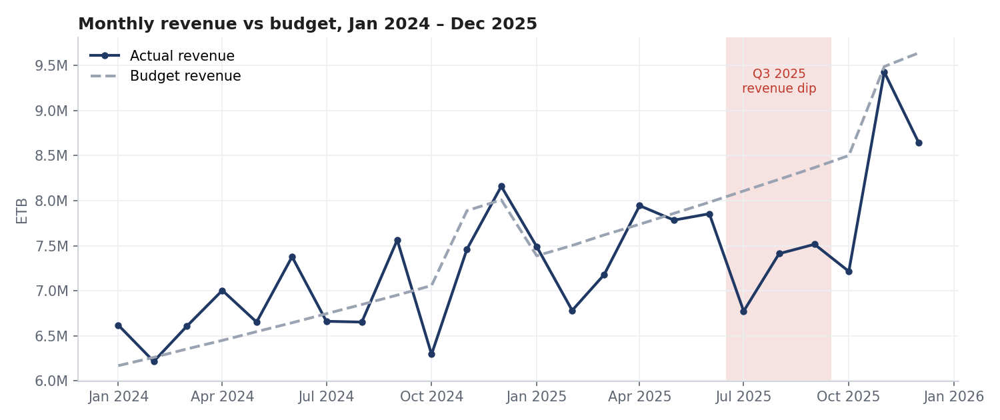
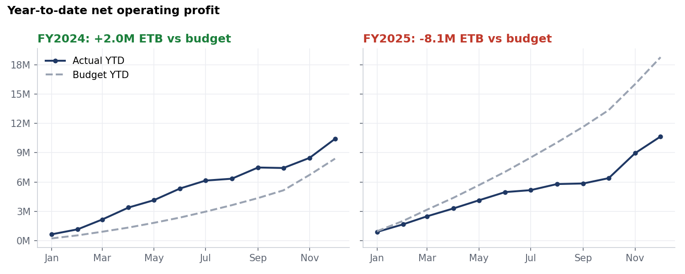
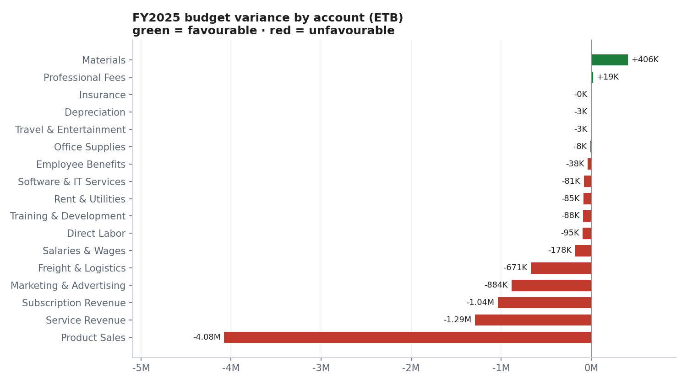
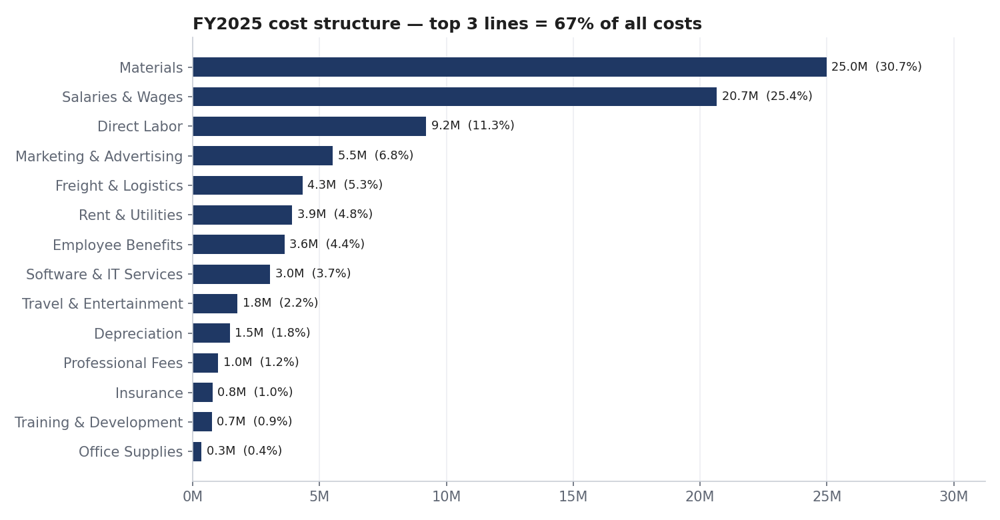

# Financial Performance, Budget Variance & Expense Analysis

**Tools:** Python (Pandas) · SQL · Microsoft Excel · Power BI
**Period:** January 2024 – December 2025 (24 months) · **Currency:** ETB (Ethiopian Birr)



---

## Project Overview

This project examines business income, operating expenses, profitability and budget performance for **Abay Trading PLC**, a mid-sized trading and services company. It gives a clear view of financial results.

It takes a messy general-ledger extract all the way to a management dashboard:
**raw data → Python cleaning → SQL reporting → Excel analysis → Power BI dashboard → executive recommendations.**

> **Data note:** The company and its data are **synthetic**. They were generated by `scripts/01_generate_raw_data.py` to look like a real finance extract, including real-world data-quality problems. No confidential data is used.

## Business Problem

Management saw FY2025 revenue grow, but profit did not follow. Finance leadership asked:

1. How did revenue, costs and profit develop over two years?
2. Where, and by how much, did actual results differ from budget?
3. Which expense categories drive costs, and are there unusual spikes?
4. Which departments are overspending?
5. What should management do in FY2026?

## Business Objectives

- Analyze revenue, expense and profit trends.
- Compare actual performance with budget targets.
- Identify major expense categories and unusual changes.
- Measure monthly budget variances.
- Build financial KPIs and management reports.

---

## Key Results (FY2025)

| KPI | Actual | Budget | Variance | vs FY2024 |
|---|---:|---:|---:|---:|
| Revenue | 92.0M | 98.4M | **−6.4M (−6.5%)** | +10.5% |
| Gross Profit | 53.5M | 60.3M | −6.8M | +7.8% |
| Operating Expenses | 42.9M | 41.5M | −1.3M (3.2% over) | +9.3% |
| **Net Operating Profit** | **10.7M** | **18.8M** | **−8.1M (−43%)** | +2.3% |
| Gross Margin | 58.2% | 61.2% | −3.1 pp | −1.4 pp |
| Net Margin | 11.6% | 19.1% | −7.5 pp | −0.9 pp |

**Headline:** FY2024 beat its profit budget by +2.0M ETB. FY2025 missed by −8.1M ETB. About 79% of the gap (6.4M) came from **revenue falling short of an 18% growth target**. The remaining 1.7M came from cost overruns in **marketing (+19%)** and **freight (+18%)**.



## Key Insights

1. **Revenue grew 10.5%, but the budget assumed ~18%.** All three revenue streams missed budget by 6–8%. The plan was too optimistic, not only the execution.
2. **Q3 2025 was the critical quarter.** Revenue was 12.2% below budget (−3.0M). Product Sales alone was −1.7M, consistent with the loss of a large wholesale account. Gross margin fell to 52.4% that quarter, versus ~60% normally.
3. **Marketing overspent by 884K (+19%).** 87% of that came from one Q2 2025 campaign, which spent 1.91M against a 1.14M budget (+67%). Revenue in the following quarter *fell*, so there is no sign of a return on that spend.
4. **Freight costs rose structurally.** From March 2025, monthly freight averaged 390K, up from 286K in 2024 (+36%), after fuel price increases. Freight is now 18% over budget. This is a lasting change, not a one-off.
5. **Subscription revenue is the growth engine.** It grew +44.8% YoY (8.6M → 12.5M) and is now 13.6% of revenue, up from 10.4%.
6. **Cost base is concentrated.** Materials, Salaries and Direct Labor make up 67% of all costs. Software & IT costs grew 28.5% YoY.
7. **One-off anomaly.** Professional fees spiked to 279K in October 2024 (3.2× the normal month) because of a legal dispute. Anomaly detection flags it automatically.
8. **Data quality.** 545K ETB of FY2025 costs, mainly salaries, had no department in the source system. Department budgets are understated until this is fixed.



## Recommendations

| # | Recommendation | Expected impact |
|---|---|---|
| 1 | **Re-base the FY2026 revenue budget** using a driver-based forecast (customers × volume × price) instead of a flat growth %. Add a mid-year re-forecast. | Realistic targets and earlier warning |
| 2 | **Replace the lost wholesale volume.** Set up a key-account retention program and monthly pipeline reviews for the top 20 customers. | Protects ~3M ETB per quarter at risk |
| 3 | **Gate marketing spend on ROI.** Large campaigns need a business case and a post-campaign review, and spend is released in tranches. | Avoid a repeat of the 769K Q2 overspend |
| 4 | **Renegotiate freight.** Tender the two logistics contracts, consolidate shipments, and add a fuel-surcharge clause to customer pricing. | Recover 10–15% of the 4.3M freight cost |
| 5 | **Invest behind subscriptions**, the fastest-growing and most predictable revenue stream. | Higher-quality recurring revenue |
| 6 | **Make cost-centre coding mandatory** in the accounting system and run a monthly unassigned-cost report. | Accurate department accountability |
| 7 | **Adopt the monthly variance pack.** Any account more than ±10% off budget gets a written explanation from its owner. | Faster corrective action |

---

## Project Workflow

```
data/raw  ──►  Python (clean)  ──►  data/clean  ──►  SQL (SQLite)  ──►  reports/sql_outputs
                                       │
                                       ├──►  Excel workbook (formula-driven analysis)
                                       └──►  Power BI (star schema + DAX dashboard)
```

### 1. Data Cleaning — Python / Pandas (`scripts/02_clean_data.py`)
Raw extract: **1,795 rows** → **1,739 clean transactions**.

| Issue found | Rows | Fix |
|---|---:|---|
| Exact duplicate rows | 38 | Removed |
| Test postings | 6 | Removed |
| Mixed date formats (DD/MM/YYYY, YYYY/MM/DD, DD-Mon-YYYY) | 615 | Parsed to ISO dates |
| Amounts stored as text (`"1,250.00"`, `"(300.00)"`) | 437 | Converted; brackets = negative |
| Zero-value rows | 12 | Removed |
| Inconsistent department names (`MARKETING`, `sales`) | 90 | Standardised |
| Missing department | 45 | 34 inferred from account; 11 flagged "Unassigned" |
| Missing counterparty | 30 | Set to "Unknown" |

The full log is in `data/clean/data_quality_log.csv` and in the Excel workbook.

### 2. Data Model
A **star schema** with two fact tables sharing dimensions:

- `fact_actuals`: one row per transaction
- `fact_budget`: monthly budget by account and department
- `dim_account`: 17 GL accounts (Revenue / COGS / Expense, 7 categories)
- `dim_department`: 6 departments, 3 divisions
- `Date`: calendar table

### 3. SQL Analysis (`sql/`)
`01_schema.sql` builds the tables. `02_financial_reporting_queries.sql` holds 12 reporting queries:

| Query | Business question | Techniques |
|---|---|---|
| Q01 | Annual income statement & margins | CTE, conditional aggregation |
| Q02 | Monthly P&L with MoM growth | `LAG()` |
| Q03 | Budget vs actual by account type | Multi-CTE join, sign logic |
| Q04 | FY2025 variance ranked by risk | `RANK()` |
| Q05 | Monthly & YTD profit vs budget | `SUM() OVER (PARTITION BY … ORDER BY …)` |
| Q06 | Cost mix and Pareto | Window share, cumulative % |
| Q07 | Top 10 vendors | `GROUP BY`, filters |
| Q08 | Department spend vs budget | `LEFT JOIN`, `COALESCE`, `NULLIF` |
| Q09 | Expense anomaly detection | Trailing 3-month average window |
| Q10 | Year-over-year by account | Pivot with `CASE` |
| Q11 | Quarterly KPI scorecard | `LAG(…, 4)` for YoY |
| Q12 | Data-quality check | Filtering |

Query results are saved in `reports/sql_outputs/`.

### 4. Excel Workbook (`excel/Financial_Analysis_Workbook.xlsx`)
Fully formula-driven: **739 live formulas, 0 errors**. Change the year on the *Inputs* sheet and every sheet updates.

| Sheet | Content |
|---|---|
| Inputs | Analysis year (drop-down), variance threshold, colour legend |
| KPI_Dashboard | KPIs vs budget and prior year, plus 3 charts |
| Income_Statement | Full P&L by account: actual, budget, variance, YoY |
| Monthly_PnL | 24-month trend, net profit variance, YTD running totals |
| Budget_vs_Actual | Variance by account, favourable/unfavourable status, ±10% review flags |
| Expense_Analysis | Cost share, YoY growth, % of revenue, category summary |
| Department_Analysis | Department spend vs budget |
| Data_Quality_Log | Cleaning audit trail |

Excel skills shown: `SUMIFS`, `COUNTIF`, `IF`/`IFERROR`, data validation, conditional formatting, named inputs, charts, and financial-model colour conventions.

### 5. Power BI Dashboard (`powerbi/`)
- `DAX_Measures.dax`: 60+ measures, including P&L, budget, sign-aware variance, time intelligence (`SAMEPERIODLASTYEAR`, `TOTALYTD`, `DATEADD`), rolling 3-month anomaly detection, `RANKX`, and dynamic titles
- `Power_BI_Build_Guide.md`: step-by-step build: Power Query, relationships, 4 report pages, drill-through, bookmarks, and validation figures
- `finance_theme.json`: custom report theme

**Dashboard pages:** Executive Overview · Budget vs Actual · Expense Analysis · Department Performance

<!-- Add your Power BI screenshots here once built:


-->



---

## Deliverables

- [x] Cleaned financial dataset: `data/clean/`
- [x] Excel financial analysis workbook: `excel/`
- [x] SQL queries for financial reporting: `sql/`
- [x] Revenue and expense dashboard: `powerbi/`
- [x] Budget-versus-actual variance report: Excel *Budget_vs_Actual* sheet, SQL Q03–Q05, Power BI page 2
- [x] Executive summary and recommendations: `reports/Executive_Summary.md`

## Repository Structure

```
financial-performance-analysis/
├── data/
│   ├── raw/                    # messy source extracts
│   └── clean/                  # analysis-ready tables + cleaning log
├── scripts/
│   ├── 01_generate_raw_data.py
│   ├── 02_clean_data.py
│   ├── 03_run_sql.py
│   ├── 04_build_excel.py
│   └── 05_make_charts.py
├── sql/
│   ├── 01_schema.sql
│   └── 02_financial_reporting_queries.sql
├── excel/Financial_Analysis_Workbook.xlsx
├── powerbi/
│   ├── DAX_Measures.dax
│   ├── Power_BI_Build_Guide.md
│   └── finance_theme.json
├── reports/
│   ├── Executive_Summary.md
│   └── sql_outputs/
├── images/
├── requirements.txt
└── README.md
```

## How to Reproduce

```bash
pip install -r requirements.txt
python scripts/01_generate_raw_data.py   # create raw data (fixed random seed)
python scripts/02_clean_data.py          # clean + build model tables
python scripts/03_run_sql.py             # load SQLite, run all queries
python scripts/04_build_excel.py         # build Excel workbook (open in Excel to calculate)
python scripts/05_make_charts.py         # README charts
```
Then follow `powerbi/Power_BI_Build_Guide.md` to build the dashboard.

## Business Value

The project helps businesses improve financial visibility, monitor spending, identify variances, and support evidence-based planning. The same pipeline can be pointed at a real GL export and refreshed every month.

## Skills Demonstrated

Data cleaning · Data modeling (star schema) · SQL window functions · Financial analysis (P&L, margins, variance analysis) · Excel modeling · DAX & time intelligence · Dashboard design · Business storytelling & recommendations

---

**Author:** *[Zekarias Adefris ]* ·· [Zekiostheone@gmail.com
](#)
